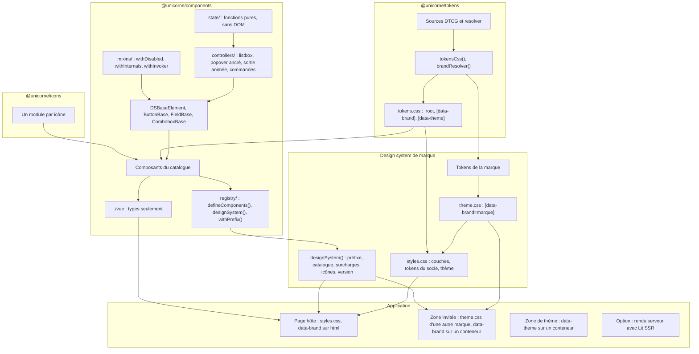

# Plan de migration du socle `@unicorne/*`

**Date :** 16 novembre 2026

Ce plan applique les ADR 0010 à 0015. Les constats et leurs preuves sont dans [rapport.md](rapport.md). Chaque étape cite l'ADR qu'elle applique : une étape dont l'ADR est refusé sort du plan.

## État au 16 novembre 2026

Les ADR 0010, 0012, 0013 et 0014 sont acceptés et appliqués. Les ADR 0011 et 0015 sont reportés à la version finale du socle : la matrice ne change pas, et Changesets n'est pas ajouté.

| Étape                               | État                                                                                          | Vérification                                                                    |
| ----------------------------------- | --------------------------------------------------------------------------------------------- | ------------------------------------------------------------------------------- |
| 1 — Mesurer                         | Faite en partie : `npm run coverage`. Le job `compat-runtime` est reporté avec l'ADR 0011     | `npm run coverage` : 93,0 % des lignes, 85,0 % des branches, dans Chromium      |
| 2 — Versions et porte de rupture    | Reportée avec l'ADR 0015                                                                      | —                                                                               |
| 3 — Importer le socle dans Node     | Faite                                                                                         | `examples/acme-vue-app/vite.config.ts` importe ACME dans Node                   |
| 4 — Portées de marque et de thème   | Faite                                                                                         | `npm run example` : une zone ACME et une zone sombre dans une page du socle     |
| 5 — Pilote `autocomplete`           | Faite                                                                                         | `npx vitest run --project unit packages/components/src/state`                   |
| 6 — Contrôleurs et rendu serveur    | Faite                                                                                         | `npx vitest run --project ssr` : 8 composants rendus et hydratés dans 3 moteurs |
| 7 — Types pour Vue                  | Faite                                                                                         | `npm run example` : `vue-tsc` refuse 3 fautes de `src/TypeCheck.vue`            |
| 8 — Coexistence des enregistrements | Faite                                                                                         | `npx vitest run packages/components/src/registry`                               |
| 9 — Accessibilité des formulaires   | Faite en partie : soumission par Entrée, libellés par enregistrement, annonce des suggestions | `npx vitest run packages/components/src/components/field`                       |
| 10 — Révision de la matrice         | Reportée avec l'ADR 0011                                                                      | —                                                                               |

Écarts avec le plan :

- **Sortie animée :** trois fonctions, pas un contrôleur. Elles ne tiennent aucun état d'un composant.
- **`ListboxController` :** il ne tient pas l'option active. Le composant la tient, par `comboboxReducer()`.
- **Thèmes emboîtés :** les sélecteurs donnent à une marque le thème de la zone la plus proche, sur deux niveaux. La règle « répéter `data-theme` » de la première version de l'ADR 0013 n'existe plus.
- **`icon` :** le test de rendu serveur a révélé un troisième composant à corriger. Une icône déjà en cache cassait l'hydratation.
- **Poids d'`autocomplete` :** 7,8 kB en gzip sans Lit, au-dessus du budget de 7,5 kB. L'écart vient de la soumission par Entrée, de l'annonce des suggestions et du réducteur. `text-field` passe de 3,4 à 3,8 kB.
- **Étape 9 :** le protocole des tests manuels avec lecteurs d'écran est écrit, avec les annonces attendues ([Tester avec un lecteur d'écran](../guides/tests-lecteurs-ecran.mdx)). Aucun test n'a été fait.

Constats mineurs traités le 17 novembre 2026 :

| Id  | Correction                                                                                                                  | Vérification                                                    |
| --- | --------------------------------------------------------------------------------------------------------------------------- | --------------------------------------------------------------- |
| A1  | `FieldBase` active `:state(user-invalid)` par `customStates`, pendant qu'une erreur s'affiche, comme `:user-invalid`        | `packages/components/src/components/field/field-base.test.ts`   |
| A2  | `scripts/pack-manifest.mjs` retire la condition `@unicorne/source` au `prepack`, et rend le `package.json` au `postpack`    | `npm run example` refuse une archive qui la garde               |
| A3  | `designSystem()` appelle `forDesignSystem()` sur chaque classe. `Icon` la surcharge : le registre ne nomme aucun composant  | `packages/components/src/registry/design-system.test.ts`        |
| A4  | `button` soumet par un `<button>` natif masqué, qui porte son `name` et sa `value`. `click()` sur l'hôte agit comme un clic | `packages/components/src/components/button/button.test.ts`      |
| A6  | Chaque story est comparée à sa capture de référence, dans Chromium sous Linux. `npm run screenshots` les régénère           | `npx vitest run --project "storybook (chromium)"` : 45 captures |
| A7  | Un champ obligatoire affiche `required-indicator` (`*`) après son libellé, masqué aux technologies d'assistance             | Story `Required` de `text-field`, et `field-base.test.ts`       |

- **A6 :** les captures dépendent des polices du système. Elles sont faites sous WSL, avec Liberation Sans à la place de Helvetica Neue. Le premier passage de la CI sur `ubuntu-latest` les confirme ou les remplace.
- **A4 :** le `submitter` de l'événement `submit` est le bouton natif masqué, pas `u-button`. Il quitte le formulaire après l'événement.

## Architecture cible

Ce que la cible change :

| Couche                         | Aujourd'hui                            | Cible                                         | ADR  |
| ------------------------------ | -------------------------------------- | --------------------------------------------- | ---- |
| État d'un composant composite  | Des champs dans 4 fichiers             | `src/state/`, des fonctions pures             | 0010 |
| Comportement sans API publique | 4 mixins                               | 4 contrôleurs                                 | 0010 |
| Comportement avec API publique | 3 mixins                               | 3 mixins, inchangés                           | 0010 |
| Thème d'une marque             | `:root` ou un conteneur, au build      | Toujours `[data-brand="…"]`                   | 0013 |
| Thème clair ou sombre          | `html` seul                            | Tout conteneur `[data-theme]`                 | 0013 |
| Resolver d'une marque          | Écrit à la main                        | `brandResolver()`                             | 0013 |
| Feuilles compilées             | `CSSStyleSheet` à l'import             | `CSSResult` de Lit                            | 0014 |
| Types des balises              | Recopiés à la main                     | Dérivés d'un type de catalogue                | 0014 |
| Registre                       | `tagFor()`, préfixe fixé par la marque | `tagFor()`, préfixe au choix de l'application | 0012 |
| Versions                       | `0.0.0`, relecture du manifest         | Changesets, `api-diff`                        | 0015 |
| Matrice                        | Chrome 111, Firefox 115, Safari 16.4   | Inchangée, révisée en mars 2027               | 0011 |

## Composant pilote : `autocomplete`

`autocomplete` migre en premier. Il valide l'architecture cible à lui seul :

- C'est le seul composant composite du catalogue : un popup, une option active, une saisie.
- Il traverse les 4 briques qui deviennent des contrôleurs, et les 2 modules d'état.
- Il porte l'échec d'hydratation du rendu serveur (`packages/components/src/mixins/withListbox.ts:78-80`).
- Il a le filet le plus dense : 7 stories dans 3 moteurs, 16 tests de mixins, les tests d'ACME et de l'application Vue.
- Son poids mesuré, 7,0 kB en gzip sans Lit, sert de budget.

Un select suit. Il réutilise `state/listbox.ts`, `ListboxController` et `ComboboxBase` sans les modifier : c'est la preuve que les briques sont partagées.

## Étapes

Les efforts sont S (moins de 2 jours), M (une semaine) et L (deux à trois semaines), pour une personne.

### Étape 1 — Mesurer avant de changer

- **Objectif :** rendre mesurables la couverture et le comportement sur les planchers de la matrice.
- **ADR :** 0011 (D2).
- **Fichiers :** `vitest.config.ts` (un projet de couverture sur Chromium), `package.json` (script `coverage`), `.github/workflows/ci.yml` (job `compat-runtime`), `scripts/run-compat-runtime.mjs`.
- **Ruptures pour les marques :** aucune.
- **Effort :** S.
- **Risque :** faible. Les anciens navigateurs de Playwright peuvent demander une image de CI plus ancienne.
- **Critère de fin :** `npm run coverage` affiche un taux, et `npm run compat:runtime` passe sous Chromium 113, WebKit 16.4 et Firefox 115.

### Étape 2 — Versions et porte de rupture

- **Objectif :** refuser en CI une rupture sans version majeure.
- **ADR :** 0015.
- **Fichiers :** `.changeset/`, `scripts/api-diff.mjs`, `package.json` (scripts `api:diff`, `check`), `packages/*/package.json` (plages des pairs), `scripts/run-example.mjs` (`publint`, `arethetypeswrong`).
- **Ruptures pour les marques :** ACME déclare des plages majeures.
- **Effort :** M.
- **Risque :** moyen. La classification d'une différence du manifest demande des cas de test.
- **Critère de fin :** `npm run api:diff` échoue sur une branche qui retire un membre `protected` sans changeset majeur.

### Étape 3 — Importer le socle dans Node

- **Objectif :** `import "@unicorne/components"` fonctionne sur un serveur.
- **ADR :** 0014 (D3).
- **Fichiers :** `packages/components/plugins/css-import-attributes.ts`, son test, `packages/components/src/css-modules.d.ts`, `docs/reference/tokens-et-couches.mdx`.
- **Ruptures pour les marques :** le type d'un import `with { type: "css" }` change. Le code des marques ne change pas s'il passe la feuille à `static styles`.
- **Effort :** S.
- **Risque :** faible. Le test de contrat lit `adoptedStyleSheets` : il vérifie que Lit adopte toujours des feuilles partagées.
- **Critère de fin :** `npm run build && node -e "import('@unicorne/components')"` se termine sans erreur, et `npm run check` passe.

### Étape 4 — Portées de marque et de thème

- **Objectif :** une zone change de marque ou de thème.
- **ADR :** 0013.
- **Fichiers :** `packages/tokens/plugins/terrazzo-plugin.ts`, `dtcg-sources.ts`, leurs tests, `packages/tokens/css/tokens.css` (généré), `packages/tokens/testing/tokens.test.ts`, `examples/acme-design-system/` (`terrazzo.config.ts`, `package.json`, `src/styles.css`, `test/`), `examples/acme-vue-app/index.html`.
- **Ruptures pour les marques :** l'option `scope` disparaît. Le resolver écrit à la main disparaît. L'application pose `data-brand` sur `html`.
- **Effort :** L.
- **Risque :** élevé. Les sélecteurs de thème emboîtés ont une limite connue (ADR 0013, D3). Le contraste se vérifie dans chaque zone.
- **Critère de fin :** `npm run example` passe avec trois vérifications de plus : une zone ACME dans une page du socle, une zone sombre dans une page claire, une zone claire dans une page sombre.

### Étape 5 — Pilote : `autocomplete`

- **Objectif :** valider l'état pur et les contrôleurs sur le composant composite.
- **ADR :** 0010, 0014 (contrat de rendu serveur).
- **Fichiers :** `packages/components/src/state/listbox.ts`, `state/combobox.ts`, `src/controllers/` (4 fichiers), `src/components/combobox/combobox-base.ts`, `src/components/autocomplete/autocomplete.ts`, `vitest.config.ts` (le projet `unit` inclut `src/state/`), `custom-elements.json`.
- **Inclus :** la lecture des enfants après le premier rendu, et une live region pour le nombre de suggestions (constats I2 et I5).
- **Ruptures pour les marques :** les membres `protected` de `withListbox` et de `withAnchoredPopover` changent. ACME n'en surcharge aucun.
- **Effort :** L.
- **Risque :** moyen. Les 7 stories et les tests d'ACME et de l'application Vue doivent passer sans changement.
- **Critère de fin :** `npx vitest run --project unit packages/components/src/state` passe dans Node, `npm run check` et `npm run example` passent, et `autocomplete` pèse au plus 7,5 kB en gzip sans Lit.

### Étape 6 — Généraliser les contrôleurs et le contrat de rendu serveur

- **Objectif :** retirer les 4 mixins remplacés, et garantir le rendu serveur de tout le catalogue.
- **ADR :** 0010 (D2, D3), 0014 (D2).
- **Fichiers :** `packages/components/src/components/modal/modal.ts`, `src/components/alert/alert.ts`, `src/mixins/` (4 fichiers retirés), `src/index.ts`, `vitest.config.ts` (projet `ssr`), `src/ssr-contract.test.ts`, `docs/reference/mixins.mdx`, `.claude/skills/lit-mixin/SKILL.md`, `.claude/skills/lit-component/SKILL.md`.
- **Ruptures pour les marques :** `withCommands`, `withExitTransition`, `withAnchoredPopover` et `withListbox` sortent des exports. Un composant de marque crée un contrôleur.
- **Effort :** M.
- **Risque :** moyen. `modal` a 12 stories, dont la sortie animée dans Firefox et WebKit.
- **Critère de fin :** `npx vitest run --project ssr` rend et hydrate les 8 composants sans erreur, dans les trois moteurs.

### Étape 7 — Types pour Vue

- **Objectif :** `vue-tsc` vérifie les propriétés et les événements de chaque balise.
- **ADR :** 0014 (D1).
- **Fichiers :** `packages/components/src/registry/catalog.ts` (`Catalog`), `src/vue.ts`, `packages/components/package.json` (export `./vue`), `src/define.ts`, `examples/acme-design-system/src/` (`define.ts`, `vue.ts`), `examples/acme-vue-app/` (`tsconfig.json`, un fichier de test de types), `docs/guides/application-vue.mdx`.
- **Ruptures pour les marques :** aucune. Les `HTMLElementTagNameMap` écrits à la main deviennent une ligne.
- **Effort :** S.
- **Risque :** faible. Le type compile déjà dans un essai.
- **Critère de fin :** `npm run example` échoue quand `App.vue` écrit `:labell` sur `acme-text-field`, et passe sans cette faute.

### Étape 8 — Coexistence des enregistrements

- **Objectif :** une application isole sa copie d'une marque, et un conflit de versions se lit.
- **ADR :** 0012.
- **Fichiers :** `packages/components/src/registry/design-system.ts`, `define-components.ts`, leurs tests, `examples/acme-design-system/src/design-system.ts`, `docs/guides/design-system-de-marque.mdx`.
- **Ruptures pour les marques :** aucune. `version` est une option de plus.
- **Effort :** S.
- **Risque :** faible.
- **Critère de fin :** `npx vitest run packages/components/src/registry` passe avec un test qui enregistre ACME sous `acme` et `acme2`.

### Étape 9 — Accessibilité des formulaires

- **Objectif :** corriger les constats I6 et I7, et tracer les tests manuels.
- **ADR :** aucun.
- **Fichiers :** `packages/components/src/components/field/field-base.ts` (soumission par Entrée), `src/registry/design-system.ts` (option `labels`), `src/components/modal/modal.ts`, les stories des champs, un document DSDS par champ avec `checkedBy`.
- **Ruptures pour les marques :** aucune.
- **Effort :** M.
- **Risque :** moyen. Les tests manuels demandent NVDA, JAWS, VoiceOver et TalkBack.
- **Critère de fin :** `npm run check` passe avec une story qui soumet un formulaire par Entrée, et `npm run dsds` valide les règles marquées `manual`.

### Étape 10 — Révision de la matrice

- **Objectif :** décider du plancher Popover API avec les statistiques de Courses U.
- **ADR :** 0011 (D1).
- **Fichiers, si le plancher monte :** `package.json` (`browserslist`), `docs/reference/support-navigateurs.mdx`, `packages/components/src/controllers/` (branche sans top layer), `src/polyfills/anchor-positioning.ts`.
- **Ruptures pour les marques :** le public sous le plancher perd le support.
- **Effort :** S.
- **Risque :** faible pour le code. La décision est celle du produit.
- **Critère de fin :** `npm run compat && npm run compat:runtime` passent sur la matrice retenue.
- **Date :** mars 2027, à la fin de Firefox ESR 115.

## Ordre et dépendances

| Étape                | Dépend de | Peut avancer en parallèle de |
| -------------------- | --------- | ---------------------------- |
| 1 — Mesurer          | —         | 2                            |
| 2 — Versions         | —         | 1                            |
| 3 — Import dans Node | 1         | 4                            |
| 4 — Portées          | 1, 2      | 3                            |
| 5 — Pilote           | 1, 3      | 4, 7                         |
| 6 — Généraliser      | 5         | 7, 8                         |
| 7 — Types pour Vue   | 2         | 5, 6                         |
| 8 — Coexistence      | 2         | 6, 7                         |
| 9 — Accessibilité    | 5         | 8                            |
| 10 — Matrice         | 1         | —                            |

Les étapes 1 à 4 lèvent les quatre constats bloquants. La première publication du socle suit l'étape 6 : les ruptures des étapes 3 à 6 restent ainsi hors de toute version publiée.
